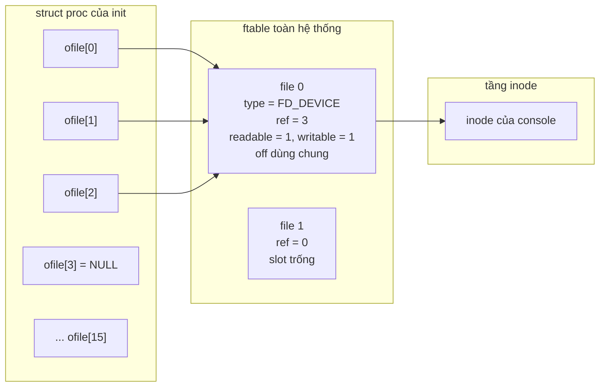
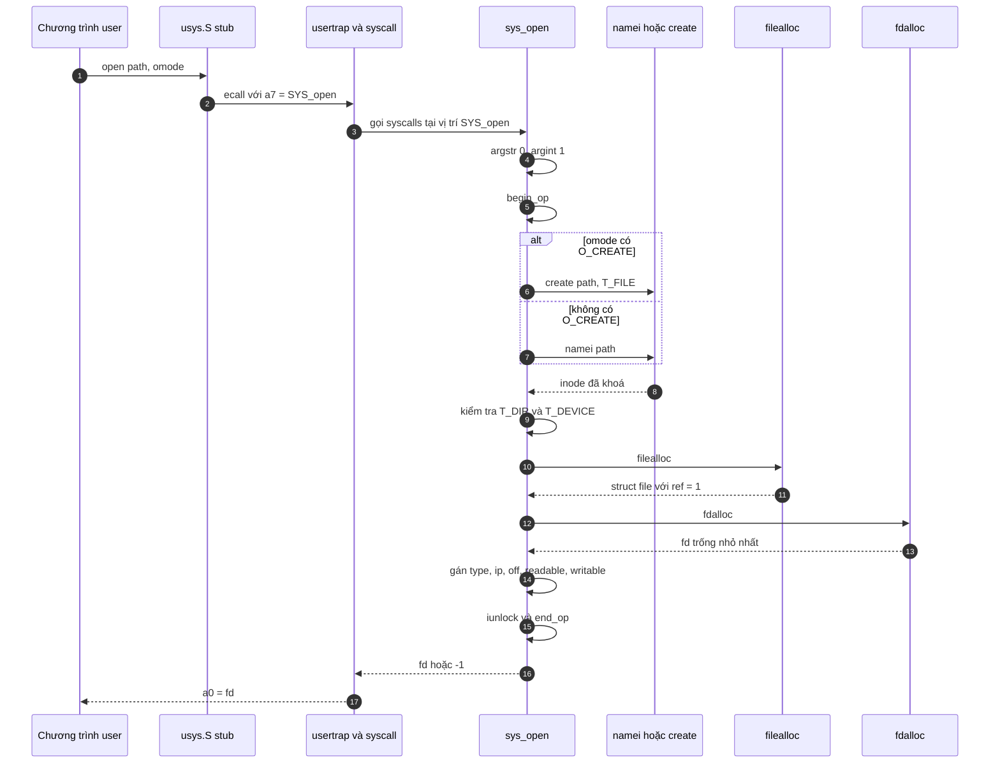
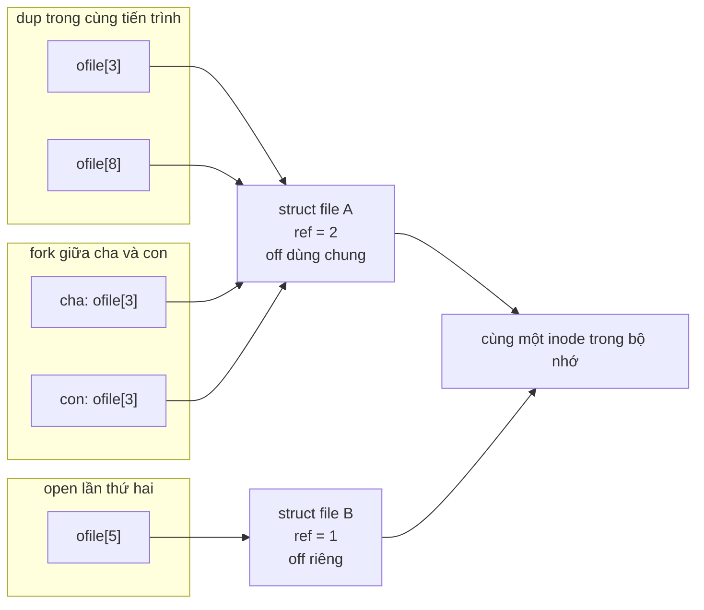
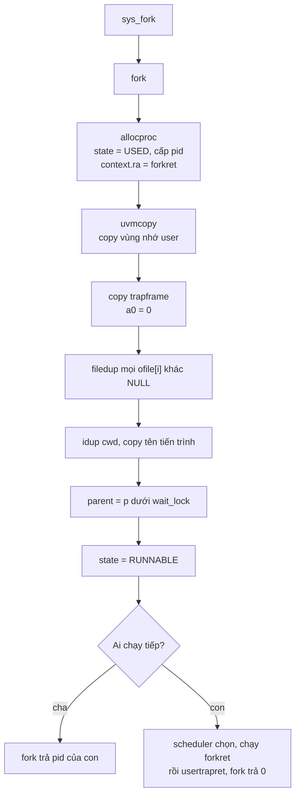
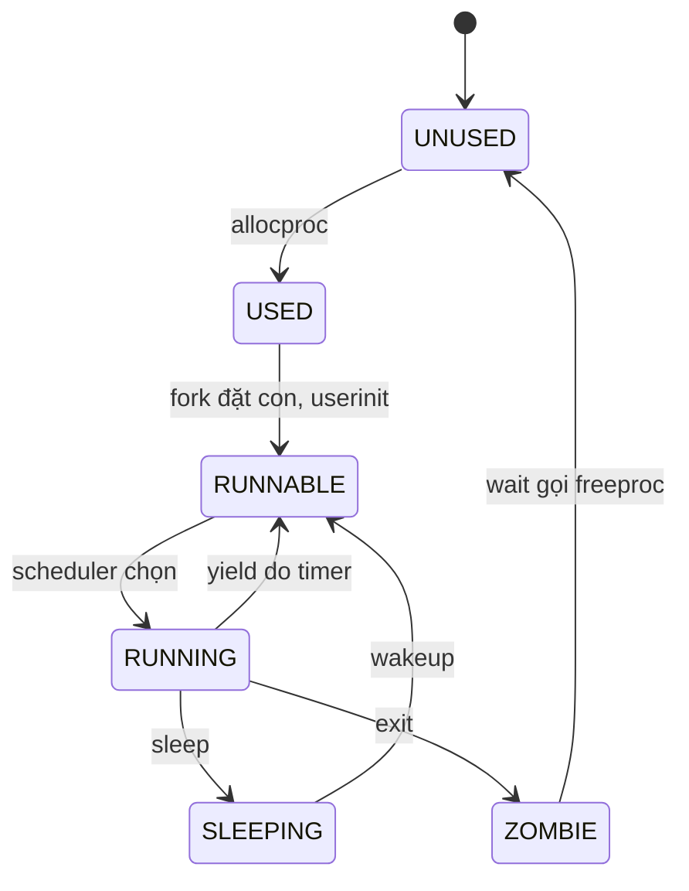

# Báo cáo Lab 1 – File & Process Management

Bản báo cáo này trình bày phần **khảo sát mã nguồn xv6 (mục 4.1)** của đề bài. Phần cài đặt system call `sysinfo` (mục 4.2) và kết quả kiểm thử sẽ được bổ sung sau khi hoàn tất.

## Thông tin nhóm

| STT | MSSV | Họ và tên |
| --- | --- | --- |
| 1 | 24120010 | Trần Văn Tấn Khôi |
| 2 | 24120035 | Lê Thành Đạt |
| 3 | 24120361 | Trịnh Tuấn Kiệt |

# 1. Mục tiêu và phạm vi

Mục 4.1 yêu cầu tìm hiểu cách xv6 quản lý file và tiến trình, cụ thể là: hai bảng lưu thông tin file (`ofile[]` của `struct proc` và `file[]` của `ftable`), luồng xử lý của hai system call `open` và `fork`, cách dùng file descriptor ở ba con đường `open`/`dup`/`fork`, các trường `pid`, `state`, `context` của tiến trình, và cơ chế định thời (`scheduler`, `sched`, `yield`).

Phương pháp thực hiện là **đọc mã nguồn tĩnh** trong `xv6-labs-2024` (phiên bản RISC-V của xv6, chạy trên QEMU), đối chiếu với chương 2 và mục 4.3–4.4 của sách xv6. Báo cáo không kèm thực nghiệm đo đạc tại thời điểm này; các kết luận về số đếm tham chiếu đều suy ra từ luồng code và sẽ được kiểm chứng bằng chương trình `sysinfotest` ở mục 4.2.

Bảng đối chiếu giữa yêu cầu của đề và các mục trong báo cáo:

| Yêu cầu mục 4.1 | Mục tương ứng |
| --- | --- |
| `ofile[]` của `struct proc`, `file[]` của `ftable` | 2.1 |
| Luồng `syscall open` | 2.2 |
| So sánh file descriptor trong `open`, `dup`, `fork` | 2.3 |
| `pid`, `state`, `context` của `struct proc` | 2.4 |
| Luồng `syscall fork` | 2.5 |
| Cơ chế `scheduler()`, `sched()`, `yield()` | 2.6 |

# 2. Khảo sát

## 2.1. Hai tầng quản lý file: `ofile[]` và `ftable.file[]`

### 2.1.1. File descriptor là chỉ số, không phải file

Mỗi tiến trình sở hữu một mảng `ofile[]` nằm ngay trong `struct proc` (`kernel/proc.h:106`), với kích thước `NOFILE = 16` (`kernel/param.h:3`). Phần tử `ofile[fd]` là một con trỏ tới `struct file`, hoặc bằng 0 nếu descriptor đó chưa được dùng. Như vậy **file descriptor chỉ là một số nguyên nhỏ, đóng vai trò chỉ số** vào bảng riêng của tiến trình; bản thân nó không chứa thông tin gì về file.

Điều này giải thích vì sao mọi system call nhận file descriptor (`read`, `write`, `close`, `dup`, `fstat`...) đều phải đi qua bước kiểm tra `argfd()` (`kernel/sysfile.c:22`): hàm này kiểm tra `fd` nằm trong khoảng `[0, NOFILE)` và `ofile[fd]` khác 0, rồi mới trả về con trỏ `struct file` tương ứng. Một `fd` âm, quá lớn, hoặc đã bị `close` đều bị từ chối ngay tại đây.

### 2.1.2. `ftable` và `struct file`

Ở tầng thứ hai, toàn hệ thống có đúng một bảng `ftable` (`kernel/file.c:17-20`). Điểm cần lưu ý về mặt cú pháp: `ftable` là **một biến toàn cục** có kiểu struct không tên, chứ không phải một kiểu tên là `struct ftable`. Đề bài viết "`file[]` của `struct ftable`" là cách gọi theo nghĩa chức năng; trong mã nguồn không tồn tại `struct ftable`.

```c
struct {
  struct spinlock lock;
  struct file file[NFILE];
} ftable;
```

`NFILE = 100` (`kernel/param.h:4`), tức tối đa 100 open file trên toàn hệ thống, trong khi mỗi tiến trình chỉ được mở tối đa 16. Hai giới hạn này độc lập: một tiến trình có thể chạm `NOFILE` trước, hoặc cả hệ thống chạm `NFILE` trước, tùy tình huống.

`struct file` (`kernel/file.h:1-10`) là **open file description** – đối tượng trung tâm của mọi thao tác đọc/ghi:

| Trường | Ý nghĩa |
| --- | --- |
| `type` | Một trong `FD_NONE`, `FD_PIPE`, `FD_INODE`, `FD_DEVICE` |
| `ref` | Số tham chiếu đang trỏ tới open file này |
| `readable` | Có được đọc hay không, suy ra từ `omode` lúc `open` |
| `writable` | Có được ghi hay không, suy ra từ `omode` lúc `open` |
| `pipe` | Con trỏ tới `struct pipe` khi `type == FD_PIPE` |
| `ip` | Con trỏ tới inode khi `type == FD_INODE` hoặc `FD_DEVICE` |
| `off` | Offset hiện tại, chỉ dùng cho `FD_INODE` |
| `major` | Số hiệu thiết bị chính, chỉ dùng cho `FD_DEVICE` |

Đề bài nhắc tới "mode" của file. Trong xv6 **không có trường `mode` nguyên vẹn** được lưu lại; thay vào đó `sys_open` chuyển `omode` thành hai cờ boolean `readable` và `writable`, và hai cờ này được kiểm tra lại trong `fileread()`/`filewrite()` trước khi thực hiện thao tác. Cách biểu diễn này đủ cho xv6 vì kernel không cần phân biệt `O_RDONLY` với `O_RDWR` sau khi đã mở.

Một điểm tinh tế: `ref` đếm **số tham chiếu từ các file descriptor**, không phải số tiến trình. Nếu một tiến trình gọi `dup()` ba lần trên cùng một fd, `ref` tăng thêm ba dù chỉ có một tiến trình. Hệ quả này rất quan trọng khi cài đặt `sysinfo` ở mục 4.2: khi liệt kê "các tiến trình đang tham chiếu tới open file", một tiến trình có thể xuất hiện một lần nhưng đóng góp nhiều đơn vị vào `ref`.

### 2.1.3. Vòng đời của `ref`

Ba hàm trong `kernel/file.c` quản lý `ref`, tất cả đều thao tác dưới `ftable.lock`:

1. `filealloc()` (`file.c:30`) quét tuần tự `ftable.file[]`, chọn phần tử đầu tiên có `ref == 0`, đặt `ref = 1` rồi trả về. Nếu hết slot, trả 0. Hàm **không** khởi tạo các trường còn lại; `sys_open` chịu trách nhiệm gán `type`, `ip`, `off`, `readable`, `writable` sau đó.
2. `filedup(f)` (`file.c:48`) tăng `ref` thêm 1, `panic` nếu `ref < 1`. Đây là thao tác "chia sẻ" một open file đã tồn tại.
3. `fileclose(f)` (`file.c:60`) giảm `ref`. Nếu vẫn còn lớn hơn 0 thì chỉ trả về. Khi `ref` về 0, hàm **sao toàn bộ `struct file` ra biến cục bộ `ff`**, đặt `type = FD_NONE`, rồi **thả `ftable.lock` trước khi** gọi `pipeclose()` hoặc `iput()`. Việc thả lock sớm là cố ý: `iput()` có thể phải chờ đĩa và đi ngủ, không được giữ spinlock trong lúc đó.

Như vậy một slot trong `ftable` được coi là tự do khi `ref == 0` (và `type == FD_NONE`). Đây cũng là tiêu chí để đếm "số open file toàn hệ thống" ở mục 4.2: đếm các phần tử có `ref > 0`, không đếm toàn bộ 100 slot.

### 2.1.4. Ví dụ: ba descriptor `0`, `1`, `2` của `init`

Đoạn đầu của `user/init.c` là minh họa rất rõ cho mô hình hai tầng:

```c
open("console", O_RDWR);  // fd 0
dup(0);                   // fd 1
dup(0);                   // fd 2
```

`open` tạo **một** `struct file` trong `ftable` với `ref = 1`; hai lần `dup` chỉ tăng `ref` lên 2 và 3, đồng thời cấp thêm hai slot trong `ofile[]`. Kết quả: `ofile[0]`, `ofile[1]`, `ofile[2]` là ba con trỏ **trỏ tới cùng một `struct file`**, `ref = 3`, và cả ba dùng chung một `off`. Khi `init` `fork()` ra `sh`, mỗi fd trong ba fd này lại được `filedup()` một lần (`kernel/proc.c:311-312`), nên tại shell `ref` của open file đó là 6 – dù toàn hệ thống chỉ có hai tiến trình đang giữ nó.

Sơ đồ dưới đây minh họa cấu trúc sau khi `init` mở console và `dup` hai lần:



Cần phân biệt ba khái niệm dễ nhầm: **file descriptor** là chỉ số trong `ofile[]`; **open file description** là `struct file` trong `ftable`; **inode** là đối tượng trên đĩa được cache trong bộ nhớ (`kernel/file.h:17-30`). Nhiều open file description có thể cùng trỏ tới một inode, và nhiều file descriptor có thể cùng trỏ tới một open file description.

## 2.2. Luồng `syscall open`

### 2.2.1. Từ user space vào kernel

Một lời gọi `open()` không đi thẳng vào kernel: prototype nằm trong `user/user.h`, còn phần thân là stub trong `user/usys.S` (sinh tự động bởi `user/usys.pl`). Stub nạp số hiệu system call vào `a7`, tham số vào `a0`–`a5`, rồi thực hiện `ecall`.

Sau trap, `usertrap()` gọi `syscall()` (`kernel/syscall.c:160`). Hàm này đọc số hiệu từ `p->trapframe->a7`, tra bảng `syscalls[num]`, gọi hàm xử lý, rồi ghi kết quả vào `p->trapframe->a0`. Theo ABI RISC-V, `a0` là thanh ghi trả về, và `usertrapret()` khôi phục nó cho chương trình người dùng.

### 2.2.2. Các bước trong `sys_open`

`sys_open()` nằm ở `kernel/sysfile.c:305`. Luồng chính gồm các bước sau:

| Bước | Việc làm | Ghi chú |
| --- | --- | --- |
| 1 | `argint(1, &omode)`, `argstr(0, path, MAXPATH)` | Lấy `omode` và copy path từ user space vào buffer kernel |
| 2 | `begin_op()` | Mở một transaction của lớp log; mọi thao tác file system phải nằm trong cặp `begin_op`/`end_op` |
| 3 | Nếu có `O_CREATE`: `create(path, T_FILE, 0, 0)` | Trả về inode **đã được khoá** |
| 4 | Ngược lại: `namei(path)` rồi `ilock(ip)` | `namei` chỉ tìm, chưa khoá; phải khoá để đọc metadata an toàn |
| 5 | Nếu là `T_DIR` và `omode != O_RDONLY`: từ chối | Không cho ghi trực tiếp vào thư mục |
| 6 | Nếu là `T_DEVICE`: kiểm tra `major` trong `[0, NDEV)` | Tránh gọi driver không tồn tại |
| 7 | `filealloc()` rồi `fdalloc(f)` | Cấp open file description, sau đó cấp slot trong `ofile[]` |
| 8 | Gán `type`, `ip`, `off = 0`, `readable`, `writable` | Với `FD_DEVICE` thì lưu `major` và không dùng `off` |
| 9 | Nếu có `O_TRUNC` và là `T_FILE`: `itrunc(ip)` | Cắt file về 0 byte |
| 10 | `iunlock(ip)`, `end_op()`, trả `fd` | Kết thúc transaction và trả descriptor |

Hai chi tiết đáng chú ý:

- `create()` trả về inode đã khoá, còn `namei()` thì không. Vì vậy nhánh `O_CREATE` **không** gọi `ilock()` lại, còn nhánh còn lại thì có. Đây là lý do hai nhánh trông không đối xứng trong code.
- `fdalloc()` (`kernel/sysfile.c:40`) quét từ `fd = 0` và chọn slot trống đầu tiên. Nhờ vậy ba descriptor `0`, `1`, `2` trở thành quy ước chuẩn cho stdin/stdout/stderr, và một fd vừa `close` sẽ được cấp lại cho lần `open` kế tiếp.

Sơ đồ tuần tự của toàn bộ luồng:



### 2.2.3. Xử lý lỗi

`sys_open` có nhiều nhánh thoát sớm, và mỗi nhánh phải hoàn trả tài nguyên đúng thứ tự:

- `argstr`/`argint` thất bại → trả `-1` ngay, chưa chiếm tài nguyên.
- `create`/`namei` thất bại → `end_op()` rồi trả `-1`.
- Ghi vào thư mục hoặc `major` không hợp lệ → `iunlockput(ip)` (mở khoá và giảm `ref` inode) rồi `end_op()`.
- `filealloc`/`fdalloc` thất bại → `fileclose(f)` nếu đã có `struct file`, rồi `iunlockput(ip)` và `end_op()`.

Trường hợp `fdalloc` thất bại sau khi `filealloc` thành công là an toàn: lúc này `type` vẫn là `FD_NONE` và chưa gán `ip`, nên `fileclose` chỉ đưa `ref` về 0 mà không gọi `iput`/`pipeclose`.

## 2.3. So sánh file descriptor trong `open`, `dup` và `fork`

### 2.3.1. Bảng so sánh

| Tiêu chí | `open()` | `dup(fd)` | `fork()` |
| --- | --- | --- | --- |
| Cấp `struct file` mới? | Có, qua `filealloc` | Không, dùng lại của `fd` | Không, dùng lại của cha |
| Cấp fd mới? | Có, fd trống nhỏ nhất | Có, fd trống nhỏ nhất | Không cấp mới; con có **cùng số fd** |
| Ảnh hưởng `ref` | Đặt `ref = 1` | `ref` tăng 1 | `ref` tăng 1 cho **mỗi** fd được kế thừa |
| Offset `off` | Riêng (với `FD_INODE`, khởi tạo 0) | **Dùng chung** với `fd` gốc | **Dùng chung** với cha |
| Phạm vi ảnh hưởng | Chỉ tiến trình gọi | Chỉ tiến trình gọi | Cha và con |
| Vị trí code | `sysfile.c:305` | `sysfile.c:55` | `proc.c:281` |

Cả ba con đường đều dẫn tới `ofile[fd]` trỏ vào một `struct file`, nhưng khác nhau ở chỗ **open file description được tạo mới hay được chia sẻ**. `open` tạo mới; `dup` và `fork` chia sẻ.

### 2.3.2. Hệ quả thực tế

Vì `dup` và `fork` chia sẻ `off`, hai descriptor được tạo theo hai cách này sẽ **nối tiếp nhau** khi đọc/ghi:

- `dup` rồi đọc lần lượt từ hai fd sẽ thấy dữ liệu nối tiếp, không đọc lại từ đầu.
- Cha và con sau `fork` cùng đọc một file sẽ chia nhau các byte, đúng như hành vi của pipeline trong shell.
- Ngược lại, `open` cùng một path hai lần tạo ra **hai open file description độc lập**, mỗi cái có `off` riêng, dù cả hai cùng trỏ tới một inode trong bộ nhớ.

`close` cũng cần được hiểu theo mô hình này. `sys_close` (`sysfile.c:98`) chỉ đặt `ofile[fd] = 0` rồi gọi `fileclose(f)`. Nếu `ref` vẫn còn (do `dup`, `fork`, hoặc tiến trình khác đang giữ), open file description **không bị huỷ** và các descriptor còn lại tiếp tục hoạt động bình thường. Chỉ khi `ref` về 0 thì tài nguyên mới được giải phóng (`iput` với inode, `pipeclose` với pipe).

Sơ đồ dưới đây so sánh ba trường hợp:



### 2.3.3. Vì sao `dup` gọi `fdalloc` trước `filedup`

Trong `sys_dup` (`sysfile.c:55`), thứ tự là `argfd` → `fdalloc` → `filedup`. Nếu `fdalloc` thất bại (bảng `ofile` đã đầy), hàm trả `-1` mà **chưa** tăng `ref`, nên không có tham chiếu bị rò. Nếu làm ngược lại, mỗi lần `dup` thất bại sẽ để lại một `struct file` bị giữ vĩnh viễn – một dạng rò rỉ tài nguyên.

Với `fork`, thứ tự ngược lại về mặt logic: con đã có bản sao `ofile[]`, nên với mỗi slot khác 0, `filedup` được gọi để tăng `ref` tương ứng. Nếu `uvmcopy` thất bại trước đó, `freeproc` sẽ dọn sạch con và không có `ref` nào bị tăng.

### 2.3.4. Trường hợp pipe

Với `FD_PIPE`, `struct file` dùng `f->pipe` thay cho `ip`/`off`. `sys_pipe` (`sysfile.c:478`) tạo **hai** open file description – đầu đọc và đầu ghi – cùng trỏ tới một `struct pipe`; `fork` chia sẻ cả hai, nên cha con giao tiếp được qua pipe. Đầu đọc chỉ nhận EOF khi mọi bản sao của đầu ghi đã đóng, vì vậy `ref` và các cờ `readopen`/`writeopen` trong `struct pipe` đều phải được theo dõi.

## 2.4. Các trường `pid`, `state`, `context` của `struct proc`

### 2.4.1. `pid` và `state`

`pid` là định danh duy nhất của tiến trình, được cấp trong `allocproc()` (`proc.c:110`) và được dùng bởi `getpid`, `kill`, `wait`, cũng như để cha nhận diện con sau `fork`. `struct proc` còn lưu `parent` – con trỏ tới tiến trình cha – nhưng trường này được bảo vệ bởi `wait_lock` chứ không phải `p->lock`, vì `wait()` quét toàn bảng để tìm con.

`state` có kiểu `enum procstate` với sáu giá trị (`proc.h:82`). Bảng dưới đây tóm tắt ai đặt trạng thái nào:

| Trạng thái | Ý nghĩa | Nơi đặt |
| --- | --- | --- |
| `UNUSED` | Slot chưa được dùng | `freeproc()` khi `wait()` dọn con |
| `USED` | Đã cấp phát nhưng chưa sẵn sàng chạy | `allocproc()` |
| `RUNNABLE` | Sẵn sàng, đang chờ CPU | `fork()`, `userinit()`, `yield()`, `wakeup()`, `kill()` (nếu nạn nhân đang ngủ) |
| `RUNNING` | Đang chạy trên một CPU | `scheduler()` khi chọn được tiến trình |
| `SLEEPING` | Đang ngủ trên một kênh chờ | `sleep()` |
| `ZOMBIE` | Đã thoát, chờ cha `wait()` | `exit()` |

Tiến trình `ZOMBIE` vẫn chiếm slot và giữ `pid` nhưng không chạy được; chỉ khi cha gọi `wait()` thì `freeproc()` mới đưa nó về `UNUSED`. Vì vậy tiến trình không được `wait` sẽ thành zombie.

### 2.4.2. `context` và `trapframe`: hai loại ngữ cảnh khác nhau

Đây là điểm dễ nhầm nhất trong `struct proc`. xv6 lưu **hai** ngữ cảnh riêng biệt:

| Tiêu chí | `struct context` | `struct trapframe` |
| --- | --- | --- |
| Mục đích | Chuyển ngữ cảnh **kernel → kernel** | Lưu trạng thái khi **user → kernel** và ngược lại |
| Nội dung | `ra`, `sp`, `s0`–`s11` (14 thanh ghi) | Toàn bộ thanh ghi user, `epc`, `kernel_satp`, `kernel_sp`, `kernel_trap`, `kernel_hartid` |
| Ai lưu/khôi phục | `swtch()` trong `kernel/swtch.S` | `uservec`/`userret` trong `kernel/trampoline.S` |
| Vị trí | Nằm trong `struct proc` (và trong `struct cpu`) | Nằm ở một trang riêng, được ánh xạ vào page table của tiến trình |
| Khi nào dùng | Mỗi lần scheduler đổi tiến trình | Mỗi lần vào/ra kernel |

Vì sao `context` chỉ cần 14 thanh ghi? Vì `swtch()` là một lời gọi hàm C bình thường. Theo quy ước gọi hàm của RISC-V, các thanh ghi **caller-saved** (`a0`–`a7`, `t0`–`t6`) đã được trình biên dịch tự động lưu vào stack của kernel thread trước khi gọi `swtch()`. Chỉ các thanh ghi **callee-saved** (`s0`–`s11`), `ra` và `sp` là cần được lưu tường minh, vì chúng phải giữ nguyên giá trị qua lời gọi. Nhờ vậy `swtch()` chỉ cần vài chục lệnh load/store, rất rẻ so với việc lưu toàn bộ thanh ghi.

`trapframe` thì khác: nó chứa **toàn bộ** trạng thái của chương trình người dùng tại thời điểm trap, kể cả `epc` (địa chỉ lệnh bị ngắt) và các thanh ghi `a0`–`a7`. Khi system call trả về, `syscall()` đã ghi kết quả vào `p->trapframe->a0`; `usertrapret()` và `userret` khôi phục toàn bộ thanh ghi từ trapframe rồi `sret` về user space.

`struct cpu` (`proc.h:22`) cũng có một `struct context` riêng. Đó là ngữ cảnh của **kernel thread điều phối** trên CPU đó: khi `swtch(&c->context, &p->context)` được gọi, ngữ cảnh của scheduler được lưu vào `c->context`, còn ngữ cảnh của tiến trình được nạp từ `p->context`. Nhờ vậy mỗi CPU có thể quay lại đúng vòng lặp `scheduler()` sau khi tiến trình nhường CPU.

### 2.4.3. Đồng bộ hoá

`struct proc` có một spinlock riêng `p->lock`. Các trường `state`, `pid`, `chan`, `killed`, `xstate` phải được đọc/ghi khi giữ lock này. Riêng `parent` được bảo vệ bởi `wait_lock` toàn cục, vì `wait()` cần quét nhất quán quan hệ cha–con trong khi `fork()` và `exit()` có thể thay đổi nó.

Các trường còn lại như `ofile[]`, `cwd`, `sz`, `pagetable`, `trapframe`, `name` là **riêng của tiến trình**: chỉ chính tiến trình đó sửa, nên không cần `p->lock`. Đây là lý do `fork()` có thể đọc `p->ofile[i]` mà không cần giữ lock của cha. Tuy nhiên, khi một tiến trình khác (ví dụ system call `sysinfo` ở mục 4.2) muốn đọc `ofile[]` của tiến trình khác, nó phải cẩn thận với thứ tự lock để tránh deadlock.

## 2.5. Luồng `syscall fork`

### 2.5.1. Các bước

`sys_fork()` (`kernel/sysproc.c:25`) chỉ đơn giản gọi `fork()` trong `kernel/proc.c:281`. Luồng chính:

1. **`allocproc()`** (`proc.c:110`): quét bảng `proc` tìm slot `UNUSED`, đặt `state = USED`, cấp `pid`, cấp một trang `trapframe`, tạo page table rỗng, và khởi tạo `context` với `ra = forkret`, `sp = kstack + PGSIZE`. Hàm trả về với `p->lock` **đang được giữ**.
2. **`uvmcopy()`**: copy toàn bộ vùng nhớ người dùng của cha sang con. xv6 bản này **copy eager**, không dùng copy-on-write.
3. **Copy trapframe**: `*(np->trapframe) = *(p->trapframe)`, sau đó đặt `np->trapframe->a0 = 0`. Đây là chi tiết khiến `fork()` trả về 0 ở tiến trình con.
4. **Kế thừa file**: với mỗi `i` mà `p->ofile[i] != 0`, gán `np->ofile[i] = filedup(p->ofile[i])`. Nhờ đó con có cùng số fd và cùng open file description với cha.
5. **Kế thừa thư mục hiện tại**: `np->cwd = idup(p->cwd)`.
6. **Gán cha**: `acquire(&wait_lock); np->parent = p; release(&wait_lock)`. Việc dùng `wait_lock` thay vì `p->lock` giúp `wait()` quét bảng mà không phải xen kẽ hai loại lock.
7. **Đặt `RUNNABLE`** dưới `np->lock`, rồi trả `pid` cho cha.

Sơ đồ luồng:



### 2.5.2. Vì sao `fork()` "trả về hai lần"

Trong cùng một lời gọi `fork()`, có hai luồng thực thi tiếp tục từ hai kernel stack khác nhau:

- **Cha** tiếp tục ngay trong hàm `fork()`, nhận `pid` của con và trả về user space qua đường `usertrapret()` thông thường.
- **Con** chưa từng chạy trong `fork()`. Khi scheduler chọn nó, `swtch()` nạp `p->context` có `ra = forkret`, nên luồng thực thi bắt đầu tại `forkret()` (`proc.c:528`). Hàm này thả `np->lock` (lần đầu tiên còn gọi `fsinit`), rồi gọi `usertrapret()` để quay về user space. Vì `trapframe` của con là bản copy của cha với `a0 = 0`, lệnh `ecall` của con "trả về" giá trị 0.

Nói cách khác, `fork()` không thực sự chạy hai lần; nó chỉ tạo ra hai ngữ cảnh cùng quay về một điểm trong chương trình người dùng, với hai giá trị `a0` khác nhau.

### 2.5.3. Xử lý lỗi

Nếu `uvmcopy` thất bại (hết bộ nhớ), `fork()` gọi `freeproc(np)` để trả slot về `UNUSED`, thả `np->lock` và trả `-1`. Lúc này `np->ofile[]` vẫn toàn 0 vì vòng `filedup` chưa chạy, nên không có `ref` nào bị tăng. Nếu `allocproc()` thất bại ngay từ đầu, hàm trả `-1` mà không cần dọn gì.

Một chi tiết nhỏ nhưng quan trọng: `fork()` copy `trace_mask` từ cha sang con (`proc.c:304`). Đây là trường được thêm ở Lab 0 để hỗ trợ system call `trace`; nếu thiếu bước này, tiến trình con sẽ mất trạng thái trace của cha.

## 2.6. Cơ chế định thời: `scheduler()`, `sched()`, `yield()`

### 2.6.1. `scheduler()`

Mỗi CPU sau khi khởi tạo đều gọi `scheduler()` (`proc.c:449`) và không bao giờ quay lại. Vòng lặp của nó:

1. Bật interrupt (`intr_on()`) để tránh deadlock khi mọi tiến trình đang ngủ.
2. Quét tuần tự toàn bộ `proc[0..NPROC-1]`, với mỗi slot thì `acquire(&p->lock)`.
3. Nếu `p->state == RUNNABLE`, đặt `p->state = RUNNING`, gán `c->proc = p`, rồi `swtch(&c->context, &p->context)`.
4. Khi tiến trình nhường CPU và quay lại `scheduler()`, `c->proc` được đặt lại 0 và `p->lock` được thả.
5. Nếu không tìm được tiến trình nào, CPU thực hiện `wfi` (wait for interrupt) để tiết kiệm năng lượng.

Việc giữ `p->lock` trong suốt quá trình chọn và chuyển ngữ cảnh bảo đảm **một tiến trình không thể được chọn bởi hai CPU cùng lúc**. Đây là lý do xv6 chạy đúng trên máy nhiều nhân dù không có hàng đợi chạy (run queue) phức tạp: toàn bộ bảng `proc` đóng vai trò hàng đợi, và lock của từng slot là điểm đồng bộ.

Cơ chế này cũng có chi phí: mỗi lần chọn tiến trình là một lần quét `NPROC = 64` slot, và không có độ ưu tiên. Đổi lại, code rất ngắn và dễ kiểm chứng.

### 2.6.2. `sched()`

`sched()` (`proc.c:495`) là cầu nối giữa kernel thread của tiến trình và `scheduler()`. Trước khi `swtch()`, nó kiểm tra bốn điều kiện bất biến và `panic` nếu vi phạm:

1. Đang giữ `p->lock`.
2. `mycpu()->noff == 1`, tức chỉ còn đúng một spinlock đang giữ (chính là `p->lock`).
3. `p->state != RUNNING`, vì tiến trình đã phải đổi trạng thái trước khi nhường CPU.
4. Interrupt đang tắt, để tránh bị ngắt giữa lúc đang chuyển ngữ cảnh.

Sau đó `sched()` lưu `intena` (trạng thái interrupt trước đó của kernel thread), gọi `swtch(&p->context, &mycpu()->context)`, rồi khôi phục `intena` khi được scheduler chọn lại. Việc lưu/khôi phục này cần thiết vì `intena` thuộc về kernel thread chứ không thuộc về CPU.

Bốn điều kiện trên biến `sched()` thành một "cửa ải" an toàn: mọi đường đi vào scheduler (`yield`, `sleep`, `exit`) đều phải chuẩn bị đúng trạng thái và lock trước khi gọi.

### 2.6.3. `yield()` và preemption

`yield()` (`proc.c:516`) thực hiện đúng ba việc: `acquire(&p->lock)`, `p->state = RUNNABLE`, `sched()`, rồi `release(&p->lock)` sau khi được chọn lại.

`yield()` được gọi từ trap handler khi có **timer interrupt**: `trap.c:80` trong `usertrap()` và `trap.c:154` trong `kerneltrap()`. Nhờ vậy xv6 có định thời **preemptive round-robin**: sau mỗi chu kỳ timer, tiến trình đang chạy bị đưa về `RUNNABLE` và nhường CPU cho tiến trình kế tiếp trong bảng. Nếu không có timer interrupt, một vòng lặp vô hạn trong user space sẽ chiếm CPU mãi mãi.

Đây cũng là điểm tự nhiên để đếm "số lần được định thời" cho mục 4.2: mỗi khi `scheduler()` đặt `state = RUNNING`, đó là một sự kiện lập lịch. Tuy nhiên cần thống nhất định nghĩa (đếm lúc được chọn chạy, hay đếm lúc nhường CPU) vì hai cách lệch nhau đúng một đơn vị ở thời điểm quan sát.

### 2.6.4. `sleep`, `wakeup`, `exit`, `wait`

Bốn hàm này hoàn thiện vòng đời trạng thái:

- `sleep(chan, lk)` (`proc.c:552`): giữ `p->lock`, thả `lk`, gán `p->chan = chan`, đặt `SLEEPING`, gọi `sched()`. Khi được đánh thức, nó xoá `chan`, thả `p->lock` và lấy lại `lk`. Thứ tự này bảo đảm không mất tín hiệu `wakeup` giữa lúc kiểm tra điều kiện và lúc ngủ.
- `wakeup(chan)` (`proc.c:583`): quét bảng, với mỗi tiến trình `SLEEPING` có `p->chan == chan` thì đặt `RUNNABLE`.
- `exit(status)` (`proc.c:351`): đóng toàn bộ `ofile[]`, `iput(cwd)`, chuyển con cho `init`, đánh thức cha, đặt `ZOMBIE`, rồi `sched()` và không bao giờ quay lại.
- `wait(addr)` (`proc.c:395`): quét con, nếu có con `ZOMBIE` thì copy `xstate` ra user space, gọi `freeproc()` (đưa về `UNUSED`) và trả `pid`. Nếu chưa có con nào thoát, nó `sleep(p, &wait_lock)`.

Sơ đồ trạng thái đầy đủ:



### 2.6.5. Nhận xét

Cơ chế định thời của xv6 tối giản nhưng đầy đủ: không độ ưu tiên, không run queue nhiều mức, mỗi CPU tự quét bảng nên tải có thể lệch giữa các nhân. Tính đúng đắn vẫn được bảo đảm nhờ `p->lock` và các bất biến của `sched()`, và toàn bộ cơ chế chỉ dựa trên một trường `state` cùng một spinlock cho mỗi tiến trình.

# 3. Giới hạn của phần khảo sát

Báo cáo chỉ dựa trên **đọc mã nguồn tĩnh**, chưa có đo đạc runtime; các kết luận về `ref`, chia sẻ `off` và thứ tự cấp fd sẽ được kiểm chứng bằng `user/sysinfotest.c` ở mục 4.2.

Các phần sau không nằm trong phạm vi khảo sát: lớp log và buffer cache (`log.c`, `bio.c`), cấu trúc ba tầng gián tiếp của inode (`addrs[]`, `NDIRECT`) cùng cách `readi`/`writei` ánh xạ offset, chi tiết bên trong `struct pipe`, và hành vi đồng thời thực sự trên nhiều CPU. Số dòng trích dẫn ứng với cây mã nguồn hiện tại; sau khi thêm `sysinfo`, nên đối chiếu lại theo tên hàm. Các giới hạn `NOFILE = 16`, `NFILE = 100`, `NPROC = 64` là hằng số biên dịch, nên đổi giá trị chỉ làm đổi kích thước bảng và chi phí quét, không đổi logic.

# 4. Kết luận

Phần khảo sát cho thấy xv6 tách biệt ba tầng: file descriptor (chỉ số trong `ofile[]`), open file description (`struct file` trong `ftable`) và inode. Sự tách biệt này lý giải ngữ nghĩa chia sẻ offset của `dup`/`fork` và tính độc lập của nhiều lần `open` trên cùng một file.

Ở phía tiến trình, `pid`, `state` và `context` phối hợp để scheduler chuyển ngữ cảnh an toàn: `state` quyết định việc được chọn, `context` đủ để lưu kernel thread, còn `trapframe` đủ để quay về user space. Đây cũng là cơ sở để cài đặt `sysinfo`: đọc `ftable.file[]`, đọc `ofile[]` của từng tiến trình và đọc `pid`/`state`/`parent` dưới đúng lock. Phần 4.2 sẽ trình bày thiết kế, đồng bộ và kiểm thử.
